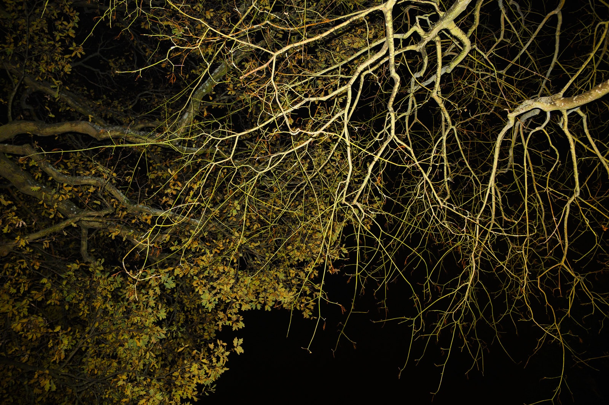
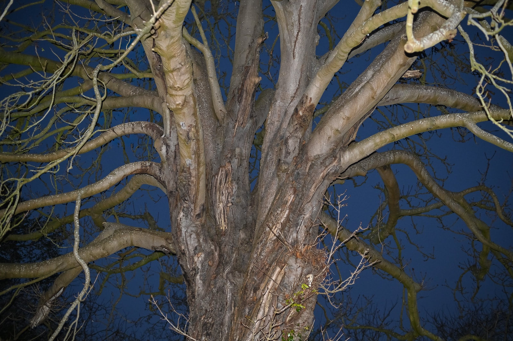
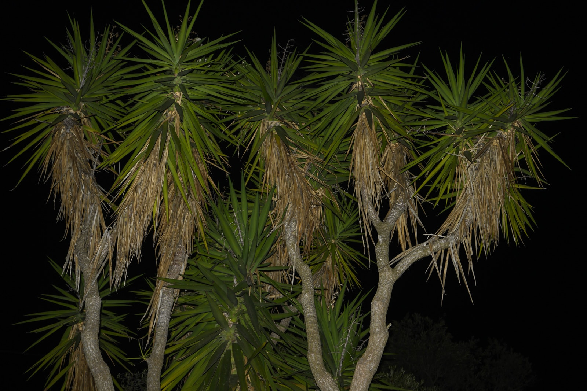
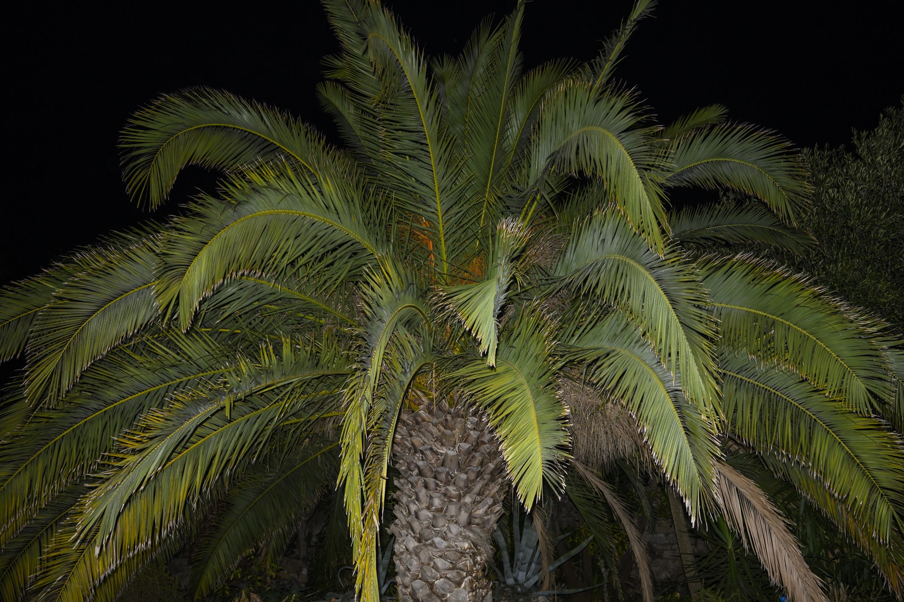

In England in late November and the darkness comes early. The trees have lost most of their leaves and I am using a flash on my camera. The **sycamore** has dropped all of theirs by now but the **oak** is still holding onto some.

I also used a flash to photograph some more exotic trees (strictly speaking, these are _plants_) in Paxos, Greece, during the Summer.

<!--and-->

