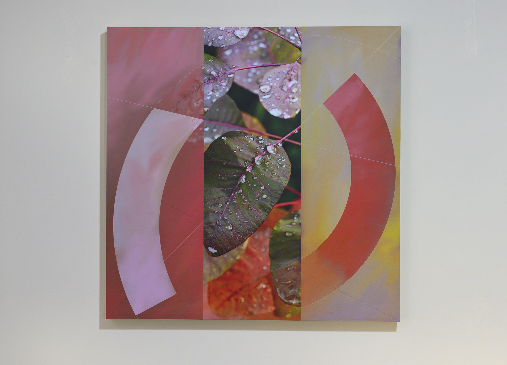

As the year moves into its third quarter in the Northern Hemisphere, the plants begin their seasonal transformation. Their leaves gradually change colour before eventually falling, and the *Smoke Bush* is particularly striking, shifting from pale green to a warm peach.

Following the rain, delicate water droplets cling to the leaves, while the stalks and contours of the leaf edges create a series of flowing curves and arcs. These natural forms are echoed in the geometry I have introduced into the composition, bringing together the organic shapes of the plant and the structure of my own interpretation.

**UV varnished archival ink on fine art paper bonded to a panel 565mm x 565mm**

<!--and-->

